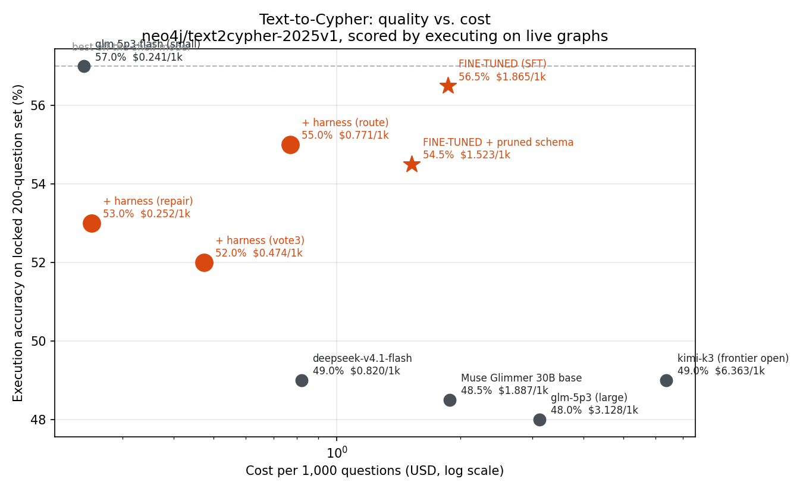
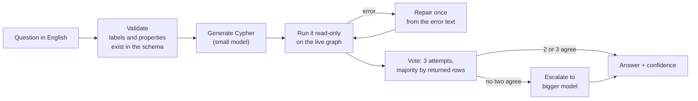

# Text-to-Cypher on open models

Ask a graph database a question in plain English and get rows back. We benchmarked open models on 200 real questions graded by running the query, and a free fine-tune of a 30B open model matched the best model we tested.



Built in one day at the Fireworks "Make your own frontier" hackathon, 2 Nov 2026.

## Results

Strict execution accuracy: the generated query must return the same rows as the answer key.

| Setup | Accuracy | Cost per 1,000 questions |
|---|---|---|
| kimi-k3 (priciest open model) | 50.0% | $6.36 |
| glm-5p3 (large) | 49.0% | $3.13 |
| deepseek-v4.1-flash | 53.0% | $0.82 |
| **glm-5p3-flash (cheapest small model)** | **60.5%** | **$0.24** |
| Muse Glimmer 30B, untuned | 51.5% | n/a |
| **Muse Glimmer 30B + fine-tuning (ours, free to train)** | **60.0%** | about $0.25 served |
| Small model + our harness with routing | 59.0% | $0.77 |

Three findings:

1. **Price does not buy accuracy here.** The cheapest model is 26x cheaper and 10 points better than the priciest. We ruled out a strict scorer, extra answer columns and reasoning budget as explanations.
2. **Fine-tuning on "did the query return the right rows" works.** 51.5% → 59.0% with supervised fine-tuning, → 60.0% with a reinforcement step on top. Training cost $0. One variant regressed to 36.5%; we documented why instead of dropping it.
3. **About 15% of the public benchmark is mis-keyed.** Of 40 hand-checked failures, the model was truly wrong 2 times. You can only see this by running every query on a live graph. Evidence: [`hackathon/cypher/audit/MISS_AUDIT.md`](hackathon/cypher/audit/MISS_AUDIT.md).

Full write-up: [`hackathon/cypher/RESULTS_FINAL.md`](hackathon/cypher/RESULTS_FINAL.md). Business case (cost per correct answer at 2,000 questions a day): [`hackathon/cypher/BUSINESS.md`](hackathon/cypher/BUSINESS.md).

## Quickstart

Needs Python 3.11+ and a Fireworks API key. The Neo4j graphs are Neo4j's free public demo servers, so there is nothing else to set up.

```bash
cd hackathon/cypher
pip install -r requirements.txt
export FIREWORKS_API_KEY=your-key
pytest test_score.py        # 31 scorer tests should pass
python3 run_eval.py --model accounts/fireworks/models/glm-5p3-flash --prompt prompts/v1_plain.txt
```

The last command prints accuracy and cost for the cheapest model on the locked 200-question set.

The offline re-scorer (`audit/rescore.py`) and the judge service (`hackathon/judge/`) read a 36 MB cache of executed queries that is not stored in git. Rebuild it once with `python3 audit/build_cache.py` (no model calls, $0).

## How it works



1. **The exam.** 200 questions from the public `neo4j/text2cypher-2025v1` test split, 40 from each of five live Neo4j demo graphs (movies, recommendations, northwind, fincen, twitter). Every answer key was produced by running the official query on the live graph. The set is locked with a fingerprint and checked before every run.
2. **The grader.** Runs each generated query and compares result sets, not text. 31 unit tests.
3. **The harness** (diagram above). It does not raise accuracy much. It makes the system safe to ship: broken queries fall from 2.2% to 0.1%, and agreement between three attempts is a usable confidence score (unanimous answers are right 64.8% of the time, split votes 35%, full disagreement 17.7%).
4. **Fine-tuning.** LoRA on Muse Glimmer 30B through the Fireworks Training API, trained on 500 rows from the *train* split only, with zero overlap with the exam (checked by script).
5. **Tracing.** Every step can be logged to Langfuse for debugging; off by default so scored runs are unaffected.

## Layout

| Path | What |
|---|---|
| `hackathon/cypher/` | The submission: exam, grader, harness, fine-tuning, audit, charts |
| `hackathon/cypher/harness/` | Validate, repair, vote, route |
| `hackathon/cypher/train/` | Fine-tuning write-up, including the failed variant |
| `hackathon/cypher/audit/` | Scorer audit and the mis-keyed-answer evidence |
| `hackathon/hf_release/` | Dataset card for the Hugging Face release |
| `hackathon/deck/` | Slides |
| `hackathon/runs/` | Earlier task explorations before we picked text-to-Cypher |

## Status

Hackathon submission, finished 2 Nov 2026. Not maintained day to day.

What's next:

1. Publish the corrected 200-question set on Hugging Face.
2. Serve the fine-tuned model on a dedicated deployment to measure its real cost (we ran out of event credits).

Found a mis-keyed answer we missed? Open an issue with the question ID.

## Credits

Built by a team of four at the event. Benchmark questions from Neo4j's public `text2cypher-2025v1` dataset.

## License

Apache-2.0. See [LICENSE](LICENSE).
