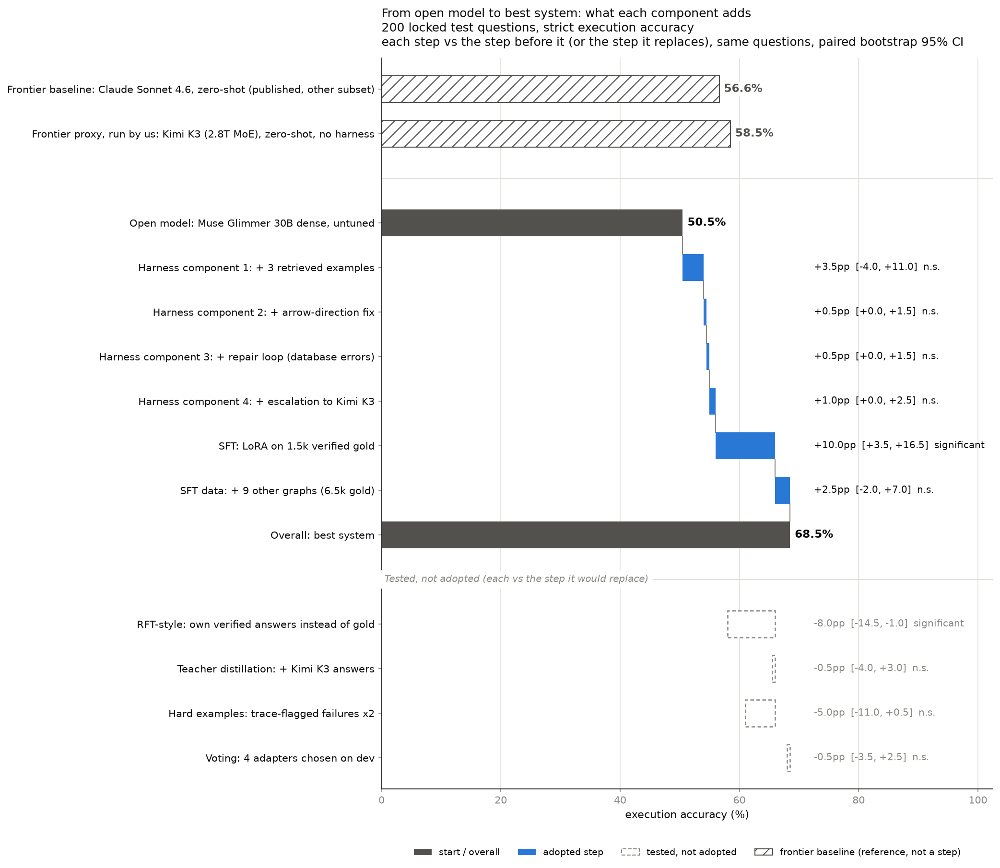

# Text-to-Cypher

An analyst asks a question in English; the system returns the right rows from a Neo4j graph, checked by running the query.
We fine-tune a 30B open model on execution-verified data and wrap it in a harness that checks its own work.

**Headline: Muse Glimmer 30B + LoRA SFT (FT-BX) + harness reaches 68.5% execution accuracy on our 200-question test set.**
The published zero-shot score of Claude Sonnet 4.6 on this dataset is 56.6%, so that is +11.9 points, at $0.0026 per question and 1.1 s.
On our exact 200 questions, the 2.8T-parameter Kimi K3 zero-shot scores 58.5%; our model beats it by +10.0 points (paired 95% CI +3.5 to +16.5, p = 0.004).

- Plan, story and full decisions log: [HARNESS.md](HARNESS.md)
- Demo script: [DEMO.md](DEMO.md)
- Dashboard: `dashboard/index.html` (Pareto charts, ablations, question explorer). Chart: `dashboard/before_after.png`



More charts: `dashboard/before_after.png` (every config vs the untuned base), `dashboard/why.png` (head-to-head wins and
why the losing side failed), and `_valid` versions of the first two on the 175 audited-fair questions.

## Results

All rows are on the same 200 locked test questions (`data/test.jsonl`, sha256 in `data/TEST_HASH`), scored by execution: the
returned rows must match the gold rows. Δ is against R1 on the same questions, with a paired bootstrap 95% CI.

| Row | Config | Accuracy (95% CI) | Δ vs R1 | $/question | p50 |
|---|---|---|---|---|---|
| — | Claude Sonnet 4.6, zero-shot (published, other subset) | 56.6% | — | — | — |
| R1 | Muse Glimmer 30B, no tuning, no harness | 50.5% (43.6–57.4) | baseline | $0.0019 | 1.1 s |
| R2 | + 3 retrieved examples | 54.0% | +3.5 (n.s.) | $0.0024 | 1.0 s |
| R5 | + arrow fix, repair loop, escalation to Kimi K3 | 56.0% (49.1–62.7) | +5.5 (n.s.) | $0.0027 | 1.0 s |
| R13 | gpt-oss-120b + harness | 56.0% | +5.5 (n.s.) | **$0.0004** | 0.9 s |
| R15 | GLM 5.3 + harness | 61.0% | +10.5 | $0.0018 | 1.5 s |
| R23 | **Kimi K3 (2.8T), zero-shot, no harness: frontier baseline run by us** | 58.5% (51.6–65.1) | +8.0 | $0.0043 | 2.9 s |
| R17 | Kimi K3 (2.8T) + harness | 63.0% | +12.5 | $0.0051 | 2.7 s |
| R22 | Qwen2.5 1.5B, untuned, local + examples + arrow fix | 15.0% | −35.5 | $0 (local) | 9.0 s |
| R7d | Muse 30B + FT-D: SFT on its own verified traces (+ gpt-oss, GLM) | 58.0% | +7.5 (n.s.) | $0.0026 | 1.1 s |
| R6z | Muse 30B + FT1, no retrieved examples | 63.5% | +13.0 | $0.0022 | 1.1 s |
| R6b | Muse 30B + FT1-big: SFT on 4,386 gold, 1 epoch | 65.5% | +15.0 | $0.0027 | 1.3 s |
| R6kd | Muse 30B + FT-KD: FT1 gold + 131 Kimi K3 answers where Muse failed | 65.5% | +15.0 | $0.0027 | 1.1 s |
| R6 | Muse 30B + FT1: SFT on 1,500 gold, 2 epochs | 66.0% (59.2–72.2) | +15.5 | $0.0026 | 1.2 s |
| R20 | Vote of 4 Muse 30B adapters (R6, R6b, R7d, R6bx), chosen on dev | 68.0% | +17.5 | $0.0106 | 1.5 s |
| **R6bx** | **Muse 30B + FT-BX: SFT on 4,386 gold + 2,114 gold from 9 other graphs** | **68.5% (61.8–74.5)** | **+18.0** | $0.0026 | 1.1 s |
| R6hf | Muse 30B + FT-HF: FT1 gold, trace-flagged failures doubled | 61.0% | +10.5 | $0.0028 | 1.2 s |

"n.s." = the paired 95% CI includes zero. Costs are Fireworks list prices; for fine-tuned rows they are training-sampler
prices (see Caveats).

### What worked and what didn't

- **Fine-tuning on verified gold is the lever:** +15 to +18 points over the base model. The harness alone adds +5.5 (n.s.).
- **Data from other graphs helps:** FT-BX vs FT1-big (same in-domain data, plus 9 other schemas) is +3.0.
- **More in-domain data alone doesn't:** FT1-big (3× data) scores 65.5%, the same as FT1.
- **Distillation doesn't beat gold:**
  - FT-D trains on the harness's own correct answers and scores 58.0%, significantly below FT1 (−8.0, p = 0.03). 760 of its 919 examples were answers the model already gave.
  - FT-KD (adding a 2.8T teacher's answers) changes nothing.
- **Upweighting hard examples needs clean labels:** FT-HF doubles the gold for the 739 training questions the harness failed and scores 61.0% (−5.0 vs FT1; −7.4 on the validated set and −9.0 on the clean subset, both p = 0.03). Many of those "failures" have wrong or ambiguous gold, so doubling them doubled the label noise.
- **Ensembles don't reliably help:**
  - A vote chosen on dev scores 68.0%, the same as the best single adapter.
  - A trio picked on the test set scored 70.0%; it is not cited, because it was chosen on test.
- **Harness stages after the examples add little:** 83 of R5's 92 misses run cleanly and return wrong rows, so the repair loop (which fires on errors and empty results) never sees them.
- **Dev-split design tests, none adopted:**
  - repair on database warnings: +0.0
  - a bigger example pool: +3, n.s.
  - embedding retrieval (qwen3-embedding-8b) at top 3 / 5 / 10: −1.0 to −2.5, n.s.

### Why each method helps (trace review, `dashboard/why.py`)

Kimi K3 (2.8T) is used as the frontier proxy: no closed frontier model was run. On the 175 audited-fair questions:
- **SFT beats the frontier proxy on everyday questions by learning the data's conventions.** Of the 23 questions only our best model gets right, Kimi K3 failed 11 by returning the right entities with different columns and 11 on logic, e.g. `LIMIT 5` with no `ORDER BY` (t177), or the title without the year (t097).
- **The big model still wins on hard multi-step queries:** 78% vs 72% on the hard tier (e.g. t072, actors in both Action and Romance). Our model wins on easy (72% vs 67%) and medium (83% vs 72%).
- **The harness's gain is mostly its examples:** 34 of the 37 base-model misses it rescues are fixed at the first attempt, once retrieved examples show the output shape. Self-correction rescues 3 (arrow fix t100, escalation t009). It also loses 21 questions the bare model got right, for a net +16.
- **Training on the model's own verified answers (RFT-style) reinforces its habits:** FT1 beats it on 33 questions, 17 of them on output columns. Gold SFT covers the questions the model fails; self-distillation only covers the ones it already solves.
- **More in-context examples help an untuned model, not a tuned one** (dev): untuned Muse goes 46.5% → 53.0% from 0 to 10 examples (p ≈ 0.07). After SFT, 10 examples score 56.0% vs 58.0% for 3.
- **Size isn't the lever:** a 30B dense model with SFT beats MoE models with 25× (GLM 5.3, 743B) and 93× (Kimi K3, 2.8T) more total parameters. Nemotron Lightning (3B active) could not be evaluated: it returns degenerate text on Fireworks (deprecated 2026-11-07).

### Robustness checks

- **Not memorization** (`contamination.py`): R6 scores 65.8% on the 111 test questions with no close paraphrase in its training data (word overlap < 0.6), and R6bx 68.8% on its clean subset. The untuned harness scores *higher* on near-duplicates, as expected from retrieval.
- **Eval-set audit** (`data/test_audit.jsonl`, `validate_eval.py`):
  - Gold is stable: a re-run matches the stored rows, and it is identical across runs.
  - All 45 questions no config solves were reviewed: 5 gold queries are wrong (e.g. they use properties that don't exist), 20 questions are ambiguous (ties, no ranking criterion), and 20 differ only in output format.
  - On the 175 valid questions every config gains about 9 points, and **the ranking is unchanged**: R6bx 77.1%, R6 75.4%, Kimi K3 71.4%.
  - The review was done by Claude Code, not humans; a human spot check is recommended.
- **Lenient scoring** (`lenient.py`; extra columns allowed) adds 1–5 points per config, and the ranking holds.
- **No tuning on test:**
  - Harness and ensemble choices were made on `data/dev.jsonl` (200 train questions in no other split).
  - Every training file passes a leak check against the test questions and gold queries.

### Caveats

- **Not a head-to-head with the frontier:** the frontier number is published (CypherGuard, arxiv.org/html/2610.41755), measured on a 1,003-question subset of the same dataset. We did not run Claude ourselves.
- **Much of the remaining strict-metric error is label noise:** of R6's 43 misses on the validated questions, ~30 return the right entities with different columns. The dataset has no consistent projection convention.
- **Serving cost:** fine-tuned LoRA adapters are served only on dedicated (hourly) deployments on Fireworks, so the $/question shown for fine-tuned rows uses training-sampler prices. Real serving cost depends on GPU-hour pricing and load.
- **Small sample:** 200 questions gives ±6.5 points of 95% CI per config; differences of 1–3 points between fine-tunes are not significant.

## Data

| | |
|---|---|
| Source | [`neo4j/text2cypher-2024v1`](https://huggingface.co/datasets/neo4j/text2cypher-2024v1) |
| Graphs | movies, recommendations, northwind, fincen, twitter, on the public read-only server `neo4j+s://demo.neo4jlabs.com` |
| Test set | `data/test.jsonl`: 200 rows (40 per graph), from the dataset's test split only. Gold rows stored per line. |
| Training pool | `data/train_pool.jsonl`: 4,586 train-split rows whose gold query runs and returns 1–200 rows. Disjoint splits: `harvest1` (1,500), `harvest2` (1,000), `rl_prompts` (400), `dev` (200). |
| Other graphs | `data/xgraph_pool.jsonl`: 2,114 verified train rows from 9 other graphs on the same server |
| Audit | `data/test_audit.jsonl`: labels and reasons for the 45 reviewed test questions |

## Scoring

`score.py` compares the rows a predicted query returned with the gold rows:
- Rows are compared as unordered multisets; column names and column order are ignored; floats are rounded to 3 decimals.
- Extra or missing columns count as wrong. `covers_gold` is the lenient variant that allows extra columns; it is never the headline.
- The result is `correct`, `wrong`, `error` (the query failed) or `empty` (no rows when gold has rows).

This is execution accuracy, as in CypherBench and CypherGuard. No BLEU and no LLM judges.

## Harness

`harness.py`, in order, stopping as soon as a query returns rows:

1. Retrieve the 3 most similar solved train questions (same graph, keyword overlap).
2. The model writes Cypher.
3. Execute it read-only on the live graph.
4. On an empty result, reverse arrows the schema declares the other way (no model call).
5. On an error or empty result, repair up to 3 times with the database error plus schema and value hints.
6. Escalate to Kimi K3.

It never sees gold; gold is used only afterwards, to score. Every question is a Langfuse trace with each model call,
each query, its rows, cost and latency.

## Setup

Run from the repo root (Python 3.11, [uv](https://docs.astral.sh/uv/)):

```bash
uv venv .venv --python 3.11
uv pip install --python .venv/bin/python neo4j datasets pytest langfuse==5.1.0 "fireworks-ai[training]" transformers matplotlib
# Secrets go in hackathon/cypher/.env (git-ignored): FIREWORKS_API_KEY, LANGFUSE_PUBLIC_KEY, LANGFUSE_SECRET_KEY,
# LANGFUSE_BASE_URL, LANGFUSE_PROJECT_ID
```

## Code

| File | What it does |
|---|---|
| `executor.py` | Runs a query read-only on the demo server. Returns rows, error and database warnings. |
| `score.py` | Grades a result against gold rows. `covers_gold`: lenient variant. |
| `fw.py` | Fireworks access: serverless chat, the training sampler (Muse base and LoRA checkpoints), embeddings. Spend ledger with a hard cap of $45. |
| `retrieve.py` | Example retrieval: keyword overlap (`Retriever`) or embeddings (`EmbeddingRetriever`). |
| `fixes.py` | Checks that need no model call: arrow-direction fix, schema hints, value lookups. |
| `harness.py` | The harness (above). |
| `tracing.py` | Langfuse tracing, one trace per question. A no-op without keys. |
| `run_eval.py` | Runs one config over a question file, grades every attempt, writes `results/<tag>.json`. |
| `metrics.py` | Summaries, and reading a full-harness run at an earlier stage (one run gives R2–R5). |
| `compare.py` | Paired comparison of two configs: bootstrap 95% CI plus exact McNemar test. |
| `vote.py` | Ensemble by result rows across runs (no model calls). |
| `contamination.py` | Scores configs on test questions with no close train paraphrase. |
| `validate_eval.py` | Scores configs on the audited subsets of the test set. |
| `lenient.py` | Strict vs lenient accuracy. |
| `build_sft.py` | SFT files: `gold`, `traces`, `repairs`, `distill`, `teacher`, with a leak check that drops and names matches. |
| `train.py` | LoRA SFT on Muse Glimmer 30B through the Fireworks Serverless Training API (free until 2026-11-30). |
| `scripts/build_pool.py` | Verifies train gold queries and writes the disjoint splits (`--other-graphs` for the 9 other graphs). |
| `scripts/backfill_rows.py` | Adds result rows to Langfuse traces recorded before rows were traced. |
| `dashboard/build.py` | Builds `dashboard/index.html`. `dashboard/before_after.py` draws the chart above. |

## Reproduce

Run from `hackathon/cypher/`, with `P=../../.venv/bin/python`.

```bash
$P -m pytest -q test_score.py test_harness.py     # 33 offline unit tests
mkdir -p raw && $P scripts/download.py neo4j/text2cypher-2024v1
$P scripts/build_pool.py                          # in-domain pool + splits
$P scripts/build_pool.py --other-graphs --per-graph 300

# baseline and harness (one full run gives R2-R5)
$P run_eval.py --tag r1_base
$P run_eval.py --tag r5_full --shots 3 --fix --repair 3 --escalate kimi-k3

# FT-BX, the headline
$P build_sft.py gold --rows data/train_pool.jsonl --exclude data/dev.jsonl --out data/sft_ft1big_gold.jsonl
$P build_sft.py gold --rows data/xgraph_pool.jsonl --examples data/xgraph_pool.jsonl --out data/sft_xgraph_gold.jsonl
cat data/sft_ft1big_gold.jsonl data/sft_xgraph_gold.jsonl > data/sft_bigx_gold.jsonl
$P train.py sft --data data/sft_bigx_gold.jsonl --tag ftbx --epochs 1          # prints the checkpoint
$P run_eval.py --tag r6bx_ftbx --model-path <checkpoint> --shots 3 --fix --repair 3 --escalate kimi-k3

# checks
$P compare.py results/r1_base.json results/r6bx_ftbx.json
$P contamination.py --train data/sft_bigx_gold.jsonl data/train.jsonl -- results/r6bx_ftbx.json
$P validate_eval.py results/r5_full.json results/r6bx_ftbx.json
$P dashboard/build.py && $P dashboard/before_after.py
```

## Reference numbers (published, not run by us)

| System | Execution accuracy | Source |
|---|---|---|
| claude-sonnet-4.6, zero-shot | 56.63% | CypherGuard, Neo4j Text2Cypher audited subset, n=1,003 |
| claude-sonnet-4.6 + CypherGuard | 62.51% | same |
| gpt-5.4-mini, zero-shot | 47.36% | same |
| gpt-5.4-mini + CypherGuard | 56.33% | same |

Source: [CypherGuard](https://arxiv.org/html/2610.41755), a different subset of the same dataset than our test set.
