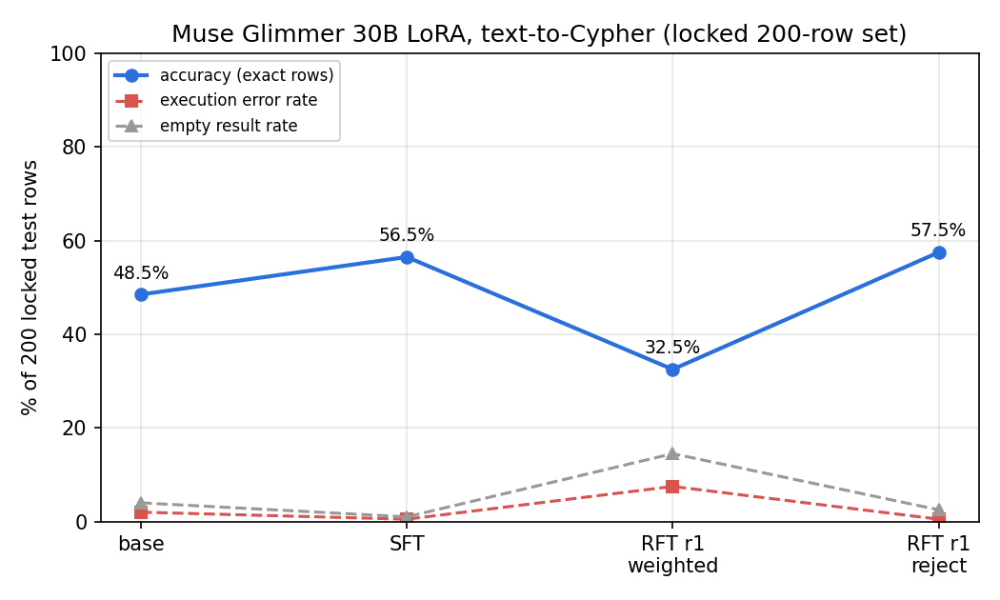

# Fine-tuning Muse Glimmer 30B for text-to-Cypher (Serverless Training API)

**Headline tuned model: SFT, 56.5% on the locked 200-row set (base 48.5%), range 56.5 to 57.0% over 3 runs.**
RFT with execution reward added nothing measurable on top (best variant 57.5%, +1.0 point, 95% CI -4 to +6). The
advantage-weighted RFT variant regressed to 32.5%; diagnosis below.

## Setup
- Base: `accounts/fireworks/models/muse-glimmer-30b`, LoRA rank 16, Serverless Training API. Training is $0 (docs: "Muse Glimmer 30B SFT is free to train until November 30, 2026", checked 11:50 PT). No dataset upload, no deployment.
- Prompt at train and test time: system = `prompts/v1_plain.txt` with the graph schema, user = question (same as `run_eval.py`). Muse's chat template, sampler prefilled with ` to=user<|message|>` so it answers without its reasoning channel; base, SFT and RFT all sampled the same way, temperature 0, max 400 tokens.
- Data: `data/train.jsonl` (500 rows, 100 per graph, sha256 63078173...f64f), `check_leak.py`: 0 overlap with `data/test.jsonl` (sha256 6c47ee00...b491 = `data/TEST_HASH`). Re-checked before each sampling run; the RFT files also pass (0 overlap).
- Scoring: `executor.py` + `score.py` unchanged; results JSONs have the `run_eval.py` shape (rows with `pred_cypher`, `exec_status`).
- Code: `train/rl.py` (eval / train / sample / build), `train/report.py` (table + `curve.png`). Run from `hackathon/cypher` with `PYTHONPATH=train/.pylib ../runs/regex/venv311/bin/python`.

## Results (200 locked rows)

| config | file | accuracy | lenient | error | empty | easy (70) | medium (87) | hard (43) | in tok/call | out tok/call | eval spend |
|---|---|---|---|---|---|---|---|---|---|---|---|
| base, no tune | results/train_base.json | 48.5% | 62.0% | 2.0% | 4.0% | 34.3% | 58.6% | 51.2% | 841 | 48.6 | $0.378 |
| **SFT** (2 ep) | results/train_sft.json | **56.5%** | 65.0% | 0.5% | 1.0% | 48.6% | 60.9% | 60.5% | 841 | 44.3 | $0.374 |
| SFT rerun, seed 1 | results/train_sft_seed1.json | 57.0% | 66.5% | 0.5% | 1.0% | 47.1% | 63.2% | 60.5% | 841 | 44.4 | $0.374 |
| SFT rerun, seed 2 | results/train_sft_seed2.json | 56.5% | 65.0% | 0.5% | 1.0% | 48.6% | 62.1% | 58.1% | 841 | 44.3 | $0.374 |
| SFT, pruned schema | results/train_sft_pruned.json | 54.5% | 62.5% | 0.0% | 2.0% | 48.6% | 59.8% | 53.5% | 668 | 43.9 | $0.306 |
| RFT r1, advantage-weighted | results/train_rft_r1.json | 32.5% | 38.0% | 7.5% | 14.5% | 21.4% | 42.5% | 30.2% | 841 | 50.1 | $0.380 |
| RFT r1, rejection sampling | results/train_rft_r1_reject.json | 57.5% | 67.0% | 0.5% | 2.5% | 50.0% | 60.9% | 62.8% | 841 | 42.6 | $0.372 |
| RFT r2 | (not run) | | | | | | | | | | |

Paired on the same 200 rows (bootstrap 95% CI, 5,000 resamples):
- base to SFT: 23 rows fixed, 7 broken, **+8.0 points [+3.0, +13.5]**. The gain is mostly on easy rows (34% to 49%): the base often returns whole nodes or extra columns where gold returns a property, which SFT learns from the gold style.
- SFT to RFT reject: 13 fixed, 11 broken, +1.0 [-4.0, +6.0]. Noise.
- SFT to RFT weighted: 11 fixed, 59 broken, -24.0 [-31.5, -16.5].
- SFT reruns (temperature 0, different sampler seed, shuffled request order) flip 2 to 3 rows: 56.5 / 57.0 / 56.5.
- Tokens per call: base 841 in / 48.6 out, SFT 841 / 44.3, SFT pruned 668 / 43.9 (schema pruning cuts 21% of prompt tokens for -2.0 points).

 Both RFT points branch from the SFT checkpoint; they are alternatives, not a sequence.

## RFT: what ran and why

Candidates: for each of the 500 training questions, 4 samples from the SFT checkpoint at temperature 0.8
(`train/results/r1_cands.jsonl`). Train gold rows were executed once and cached (`train/data/train_gold.json`, 500/500 ok).
Of 2,000 candidates: 1,137 correct, 762 wrong rows, 57 empty, 44 errors (mean reward 0.569). Per question: 184 all
correct, 114 all wrong, 202 mixed.

Reward function (`train/rl.py`):

```python
def reward(row, cypher):
    """1.0 if the candidate query executes and its result set equals gold under score.py (unordered multiset of rows,
    column names ignored, floats to 3 dp); 0.0 for wrong rows, execution errors, empty results and unparseable output."""
    pred = clean_pred(cypher)
    if not pred:
        return 0.0, "error", None
    res = execute(row["graph"], pred)
    status = score({"ok": True, **row["gold_result"]}, res, row["cypher"])
    return (1.0 if status == "correct" else 0.0), status, res
```

**Variant 1, advantage-weighted (ran first, because the API accepts it).** The Training API's `forward_backward` takes
per-token `weights` on the `cross_entropy` loss, and negative weights are accepted (step losses went negative). Each
distinct candidate of a mixed question got weight = reward - mean reward of that question's 4 candidates; all-same
questions carry no signal and were dropped. 808 samples (401 positive, 407 negative) from 202 questions (98 easy, 75
medium, 29 hard). Warm start from the SFT training state, 1 epoch, 51 steps, lr 5e-5 linear decay, batch 16. We stayed on
`cross_entropy` rather than the API's RL losses (`importance_sampling`, `ppo`, ...) because only SFT is documented as free
on this base. Result: 32.5%.

**Diagnosis of the regression** (checked in the order the judge asked):
1. Prompt mismatch: ruled out. Sampling, training and eval all build the prompt with the same two functions (`system_for` + `render`); training targets are the parsed candidate text, rendered with the same template and prefill.
2. Too few samples: ruled out. 808 weighted samples across 202 questions; tiers roughly match the train mix.
3. Not warm-started: ruled out. The session loaded the SFT state through `create_training_client_from_state` (no fallback logged). The rejection variant, loaded the same way, starts at mean NLL 0.067 on its targets versus 0.646 for a fresh base at SFT step 1.
4. Degenerate samples scored 1: ruled out. 0 empty completions with reward 1; 1 truncated candidate in 2,000, rewarded 0.
5. The loss, at this learning rate: the cause. Negative-weight cross-entropy is plain REINFORCE with no importance ratio, no clipping and no KL anchor. Pushing log-probability of a wrong sample down has no floor, so negative samples dominate the gradient once the policy drifts. Correct and wrong candidates share most of their tokens (same MATCH clause, different RETURN), so the update damages shared structure instead of picking the right ending. Symptom: the share of test predictions written as `WITH .. ORDER BY .. LIMIT .. RETURN` doubled (51 to 104 of 200) although that pattern was balanced in the positive and negative targets (65 vs 57), and empty results rose from 1.0% to 14.5%.

A fix needs a bounded objective: the API's `importance_sampling` or `ppo` loss with the sampler's logprobs, clipping and a
lower lr (about 1e-5). Those losses may bill at $5.86/M training tokens (not covered by the free SFT promo), so they were
not tried.

**Variant 2, rejection sampling (fallback, reused the same candidates).** One reward-1 candidate per question (shortest),
weight 1.0: 386 samples (168 easy, 159 medium, 59 hard). Warm start from SFT, 1 epoch, 25 steps, lr 5e-5. Result 57.5%,
within noise of SFT.

**Round 2 was not run.** A second round needs about $0.55 of new candidate sampling plus a $0.37 eval; after the coordinator's
3-seed request the ledger stood at $5.57 of $6. A first attempt at r2 sampling from the weighted r1 model was stopped at
150/316 questions once r1 scored 32.5% (cost $0.43, wasted).

## Sessions and models
| tag | training session | state | sampler checkpoint | promoted model (READY) |
|---|---|---|---|---|
| sft | ts-d620b42267a34cda8302d76b0294fc03 | deleted after save | raheeldeal/run-58f25dda56b54a00b18f5fc7a630078e/cy-sft-3830a8d8 | accounts/raheeldeal/models/cypher-sft-1150 |
| r1 weighted | ts-34fd72ca902f46009e06323fe186da11 | deleted after save | raheeldeal/run-a41bf2c26b7b42aa8e46837be7c77b02/cy-r1-8723429b | accounts/raheeldeal/models/cypher-r1-1201 |
| r1 reject | ts-2129125b63f1456cb9aa4d88e1eb7310 | deleted after save | raheeldeal/run-c97a350b3a4d4cd4833b08fa4e3f251b/cy-r1rej-bca0935b | accounts/raheeldeal/models/cypher-r1rej-1204 |

Deploy: `DEPLOY.md` (use `cypher-sft-1150`; the r1-reject model is equal within noise).

## Spend (`train/ledger.csv`, sampler at full prefill price; cached prefill would be 80% cheaper)
| item | $ |
|---|---|
| evals: base, SFT x3, SFT pruned, r1 weighted, r1 reject, smoke | 2.565 |
| RFT r1 candidates (2,000 samples; includes ~$1.29 lost to a crash at reward time, train rows had no stored gold rows; fixed) | 2.576 |
| r2 candidates, stopped | 0.428 |
| training (3 runs, 1.97M tokens) | 0.000 |
| **total** | **5.569 of 6.00** |

## Reproduce
```bash
cd hackathon/cypher; PY="env PYTHONPATH=train/.pylib ../runs/regex/venv311/bin/python"
$PY train/rl.py eval --model base --out results/train_base.json
$PY train/rl.py train --data data/train.jsonl --tag sft --epochs 2 --rank 16 --lr 1e-4
$PY train/rl.py eval --model <sft sampler path> --out results/train_sft.json      # add --seed 1 / --prune for the variants
$PY train/rl.py sample --model <sft sampler path> --out train/results/r1_cands.jsonl
$PY train/rl.py build --cands train/results/r1_cands.jsonl --mode weighted --out train/data/r1_weighted.jsonl   # or --mode reject
$PY train/rl.py train --data train/data/r1_weighted.jsonl --tag r1 --epochs 1 --rank 16 --lr 5e-5 --from-state <sft state path>
python3 train/report.py
```
